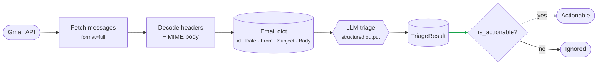

# Deed

**Deed turns the promises in your inbox into finished work.**

Connect your email, and Deed finds commitments like “I’ll send the proposal,” “I’ll set up a call,” or “I’ll share the analysis.” It researches the context, prepares the document or draft, and brings everything back for your approval before anything is sent.

**Current Pipeline**


---

## How it works

1. Connect your email account.
2. Deed scans messages for commitments and follow-ups.
3. It creates a focused action plan.
4. It researches, drafts, and prepares the required output.
5. You review and approve before Deed sends, schedules, or shares anything.

---

## Example

You receive:

> “Can you send the updated pricing deck by Friday?”

Deed can:

- Find the relevant files and context.
- Research missing details.
- Create or update the deck.
- Prepare a ready-to-send email.
- Ask for your approval before sending.

---

## Setup

### 1. Gmail OAuth

1. Create a project in [Google Cloud Console](https://console.cloud.google.com/).
2. Enable the **Gmail API**.
3. Create **OAuth client credentials** (Desktop app) and download the JSON as `credentials.json` in the project root.

Scopes used:

```python
SCOPES = ["https://www.googleapis.com/auth/gmail.readonly"]
```

Read-only is deliberate, Deed does not send, modify, or delete mail. Stage 6 will introduce a *separate, explicitly opted-in* write scope, gated by per-action approval.

### 2. Environment

```bash
# .env
GROQ_API_KEY=your_key_here
```

`token.json` is created automatically on first run and refreshed thereafter.

### 3. Run

```bash
python main.py
```

First run opens a browser for consent. Subsequent runs use `token.json`.

---

## Configuration

| Setting | Where | Default |
|---|---|---|
| `max_results` | `list_inbox()` | 10 messages |
| `body_chars` | `list_inbox()` | 800 chars of body |
| Model | `agent_summary()` | `groq:qwen/qwen3.8-27b` |
| Temperature | `model_settings` | `0` (deterministic triage) |
| Banner | `pydantic_ai.BANNER_ENABLED` | disabled |

**On model choice:** triage is a strict-structured-output task. Reasoning-heavy small models (`gpt-oss-20b`) tend to drift on JSON and invent intent values; a 70B instruct model at `temperature=0` is the reliable floor. Swap the model string to test alternatives.

---
